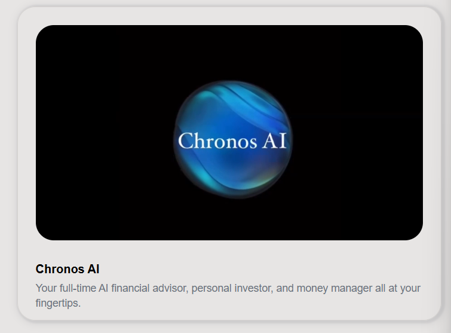

# LifeX

[https://www.notion.so](https://www.notion.so)

[https://www.notion.so](https://www.notion.so)

1. LifeX homepage

(Use the Video For the previous LifeX content)

1. Education
- Student loan managment

- Scholarship finder

- Micro Courses

- Tutor & Mentor booking

1. Financial
- main

- smart budgeting and spending

- automatic saving plans

- personalized investment advise

- credit score monitoring

- loan and mortgage managment

- tax filling assitance

1. Health
- health saving account

- insurance marketplace

- gym and fitness parthnership

- nutrition and diet plans

- mental health counsling

- wearable integration

1. Spiritual

1. Vision
- vision board and life goals

- dream saving account

- career and business planning tools

- AI career pathway planner

1. Relationship

1. Social life
