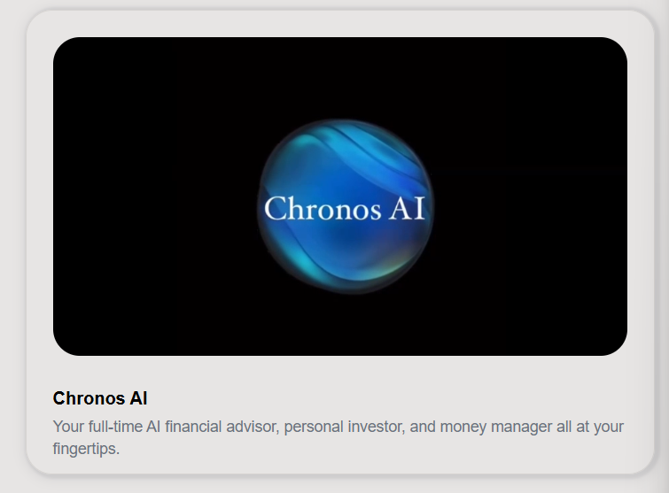

# Business

1. Business account

1. business account types
- business accout

- merchant account

- startup account

- enterprise account

1. business payments and transfers
- seemles global transaction

- global payments

- multi currency accounts

- invoice and payroll

- mass payouts

1. business smart tools
- expense management

- team cards and controls

- Panther- Business analyst

1. business financing
- fundrasing that grows with you

- business loan

- working capital lines

- merchant cash advances

1. business ai and automation

1. business security and compliance

1. pricing
2.
